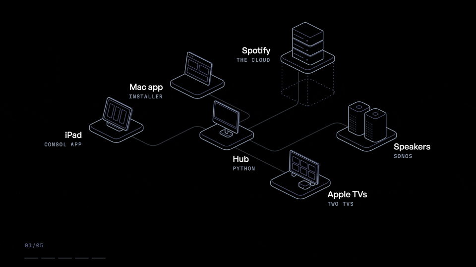

<p align="center">
  
</p>

# Consol

Consol is a home entertainment controller for one household. An always-on Mac runs a small service, the hub, that controls Sonos speakers, plays Spotify on them and drives Apple TVs. A native iPad app is the remote. A Mac app installs the hub and then serves as its control panel.

It is a personal project, published as-is for people who want to run something similar in their own home. It is not a product and is not affiliated with Sonos, Spotify or Apple.



## Contents

- [What it does](#what-it-does)
- [How it works](#how-it-works)
- [Requirements](#requirements)
- [Installation](#installation)
- [First run](#first-run)
- [Pairing Apple TVs](#pairing-apple-tvs)
- [Configuration](#configuration)
- [Limitations](#limitations)
- [Security](#security)
- [Troubleshooting](#troubleshooting)
- [Uninstalling](#uninstalling)
- [Repository layout](#repository-layout)
- [Development notes](#development-notes)
- [License and trademarks](#license-and-trademarks)

## What it does

- Plays Spotify music, podcasts and audiobooks on Sonos speakers, room by room or in groups, with play, pause, skip, seek, shuffle, repeat, volume and a live queue.
- Searches Spotify and browses artists, albums, playlists and a saved library of shows and audiobooks.
- Moves playback from one room to another, or groups rooms, from the iPad.
- Controls Apple TVs: power, launching apps, remote buttons, typing into search fields, now-playing information with artwork, and seeking.
- Signs each household member in with a four-digit PIN. The hub enforces who may do what.
- Finds the hub on the network by itself, so the iPad needs no configuration in a typical home.
- Installs the hub on a Mac through a guided setup, keeps it running across reboots, and offers a dashboard for status, users, logs and start/stop.

The iPad app organizes everything as "sessions": each card on the screen is something playing somewhere, such as an album on a speaker group or an app on a TV.

## How it works

**The hub** (`hub/`) is a Python FastAPI service. It holds every credential and does every third-party call. It exposes a small HTTP API on port 8000 and normalizes all third-party data into flat shapes, so the apps never see raw Spotify, Sonos or Apple TV payloads.

**Music playback runs locally through the speakers.** Spotify does not let third-party apps control Sonos speakers through Spotify Connect (its Web API rejects them as restricted devices). So the hub talks to the speakers directly on the LAN with [SoCo](https://github.com/SoCo/SoCo): to play something, it clears the room's Sonos queue, adds the Spotify URI with Sonos's ShareLink mechanism and starts playback. The speaker then streams the audio from Spotify itself, using the Spotify account linked in the Sonos app. Consol never handles audio. Transport and queue commands go to the coordinator of the room's Sonos group.

**The Spotify Web API is used for content only**: search, artist and album pages, playlists, shows and audiobooks. The hub keeps its own "recently played" list from what the speakers actually play.

**Apple TVs** are controlled with [pyatv](https://pyatv.dev) over the Companion and AirPlay protocols. The hub keeps one connection open per TV, so now-playing state is pushed to it instead of polled.

**The keeper** (`hub/hubkeeper.py`) is a tiny standard-library supervisor on port 8001. launchd keeps the keeper alive, the keeper starts the hub, and the keeper advertises the hub over Bonjour as `_consol-hub._tcp`. Because the keeper is always running, the iPad can find the Mac and start the hub even when the hub itself is stopped.

**The iPad app** (`Console/`) talks only to the hub. It browses Bonjour for the hub, remembers the address it found, signs the user in with a PIN and polls the hub for state.

**The Mac app** (`HubApp/`, named "CONSOL Hub") carries a copy of `hub/` inside its bundle. On a Mac without the hub it runs a setup wizard that installs everything to `~/Library/Application Support/CONSOL/hub` and registers the keeper with launchd. On a Mac that already runs the hub it shows a dashboard.

**Authentication.** Each user has a four-digit PIN, stored as a salted hash. Logging in with a PIN returns that user's API token. Every request that changes something needs the token; read-only requests such as listing rooms or searching do not.

## Requirements

### Accounts

- **Apple ID or Apple Developer Program membership** to sign and install the apps. A free Apple ID can install the iPad app on your own device from Xcode, but that install expires after 7 days and has to be reinstalled. The paid Apple Developer Program is needed for TestFlight and for installs that last a year.
- **Spotify Premium** for the household account. Sonos needs Premium to play Spotify, and Consol plays everything through the speakers.
- **A Spotify Developer app**, created at [developer.spotify.com](https://developer.spotify.com/dashboard). It provides the client ID and client secret the hub uses for search and browsing. Since February 2026, Spotify requires the owner of a development-mode app to have an active Premium subscription; the app stops working if it lapses. Using the household Premium account as the developer account is the simplest setup. Setup steps are below.

### Hardware

- **An always-on Mac** running macOS 14 Sonoma or later, on the same network as the speakers. A desktop Mac is the natural fit. It must stay awake and logged in (see [Keep the Mac awake and logged in](#keep-the-mac-awake-and-logged-in)).
- **An iPad** running iPadOS 18.1 or later. The app is designed for iPad in landscape. It also builds for iPhone, but that layout is not polished.
- **Sonos speakers** on the same network and subnet as the Mac, already set up in the Sonos app.
- **Apple TVs** (optional), on the same network. Now-playing information needs tvOS 15 or later.

### Software

- **Xcode** to build both apps. Both projects need Xcode 16 or later; they were last built with Xcode 26.3, which is recommended. An iPad running iPadOS 26 needs Xcode 26 to install development builds, and App Store Connect only accepts TestFlight uploads built with the iOS 26 SDK.
- **Python 3.10 or later** on the Mac. The hub uses syntax that fails on Python 3.9, which is the version Apple ships as `/usr/bin/python3` with the Command Line Tools. Install a current Python from [python.org](https://www.python.org/downloads/macos/) or Homebrew. The hub was developed with Python 3.12.

## Installation

The steps below use the Mac app. A [manual installation](#manual-installation-without-the-mac-app) without it is described afterwards.

### 1. Link Spotify to Sonos

Consol relies on the Sonos speakers being able to play Spotify on their own.

1. Open the Sonos app.
2. Go to Settings and open the services section (called "Services & Voice" in current versions of the app).
3. Add Spotify and sign in with the household's Spotify Premium account.

Without this link the speakers cannot resolve Spotify URIs and nothing will play. Use the same Spotify account here and in step 6.

It also helps to give each Sonos speaker and the Mac a fixed address (a DHCP reservation) in your router. See [Limitations](#limitations) for why.

### 2. Create a Spotify Developer app

1. Sign in at [developer.spotify.com/dashboard](https://developer.spotify.com/dashboard) and choose **Create app**.
2. Enter any name and description.
3. Under **Redirect URIs**, add exactly:

   ```
   http://127.0.0.1:8000/spotify/callback
   ```

   This is the hub's default (`SPOTIFY_REDIRECT_URI` in `hub/spotify.py`). Spotify only allows plain `http` redirect URIs on loopback addresses such as `127.0.0.1`, which is why the authorization in step 6 has to happen in a browser on the hub Mac.
4. Under the APIs you plan to use, select **Web API**, accept the terms and save.
5. Open the app's **Settings** and note the **Client ID** and **Client secret**.
6. If the Spotify account you will link in step 6 is not the account that owns this developer app, add it under **User Management**. New apps run in development mode, which only allows listed users (five for apps created since February 2026).

### 3. Get the code

Clone the repository on the Mac that will run the hub (replace the URL with this repository's URL):

```sh
git clone https://github.com/<owner>/consol.git
cd consol
```

### 4. Install Python 3.10 or later

The hub needs Python 3.10 or later. The `python3` that comes with the macOS Command Line Tools is 3.9, which the hub cannot run on. Check what you have:

```sh
python3 --version
```

If it is older than 3.10, install a current Python from [python.org](https://www.python.org/downloads/macos/) or with Homebrew (`brew install python`). The installer looks for Python in the Homebrew, python.org and pyenv locations, uses the first one that is 3.10 or later, and stops with a clear message if it finds none.

### 5. Install the hub with the Mac app

1. Open `HubApp/HubApp.xcodeproj` in Xcode.
2. Select the **HubApp** target, open **Signing & Capabilities**, and either choose your team or use **Sign to Run Locally**. Change the bundle identifier from `com.example.consol.hub` to your own, for example `com.yourname.consol.hub`.
3. Choose **Product > Run**. The build copies the contents of `hub/` into the app, leaving out `.env`, `data.db`, logs and any virtual environment.
4. The app checks whether the hub is already installed. On a fresh Mac it opens the setup wizard:
   - **Spotify**: paste the client ID and client secret from step 2. You can leave them blank and add them later by editing `.env`.
   - **Household**: enter the admin's name and a four-digit PIN, then add other members with their own PINs. Every PIN must be unique, because the PIN alone identifies the person at login.
   - **Network**: optionally enter the Wi-Fi network name. macOS hides the network name from background processes, so this is only used as a label on the iPad's Profile screen.
5. Choose **Install**. The wizard copies the hub to `~/Library/Application Support/CONSOL/hub`, installs its Python dependencies, writes `.env`, looks for Sonos speakers on the network, creates the users, installs the keeper as a launchd agent (`~/Library/LaunchAgents/local.consol.hubkeeper.plist`) and waits for the hub to answer.
6. If macOS asks whether CONSOL Hub may find devices on your local network, choose **Allow**. The speaker search depends on it. If the log says no speakers answered, allow access and run the install again.

When the wizard finishes, the hub is running and will start again on its own after a reboot or login.

### 6. Authorize Spotify

On the hub Mac, choose **Link Spotify** on the wizard's last page or on the dashboard's Spotify card. You can also open this address in a browser on the hub Mac:

```
http://127.0.0.1:8000/spotify/auth
```

Sign in with the household Spotify account and approve access. The browser lands on a page saying the hub is connected to Spotify. The hub stores the resulting refresh token in its database; you only do this once.

To confirm:

```sh
curl -s http://127.0.0.1:8000/spotify/status
```

The response should include `"configured": true` and `"connected": true`.

### 7. Build the iPad app

1. Download the General Sans font from [Fontshare](https://www.fontshare.com) and copy its four OTF files (`GeneralSans-Regular.otf`, `GeneralSans-Medium.otf`, `GeneralSans-Semibold.otf` and `GeneralSans-Bold.otf`) into `Console/Console/Fonts/`. Its license does not allow redistribution, so it is not in this repository. Without it the app builds and runs, using the system font for its interface text.
2. Open `Console/Console.xcodeproj` in Xcode. (The iPad app's target is named Console.)
3. Select the **Console** target, open **Signing & Capabilities**, choose your team and change the bundle identifier from `com.example.consol` to your own, for example `com.yourname.consol`.
4. For everyday use, build the Release configuration: **Product > Scheme > Edit Scheme > Run > Build Configuration > Release**. Debug builds include a safety switch for development that pauses the music about 20 seconds after the app stops polling the hub, for example when the iPad locks.
5. Connect the iPad, select it as the run destination and choose **Product > Run**.
6. If this is the first development app on the iPad, turn on **Settings > Privacy & Security > Developer Mode** and restart the iPad when asked. With a free Apple ID you also need to trust your developer certificate under **Settings > General > VPN & Device Management**.

For TestFlight, choose **Product > Archive** and upload the archive to App Store Connect under your own bundle identifier. Raise the build number for each upload.

### 8. Sign in

Open the app on the iPad and allow local network access when asked. The app needs it to find and reach the hub. Enter a PIN you created in the wizard. The app finds the hub through Bonjour, so there is nothing to configure when the iPad and the Mac are on the same network. If the login screen says it can't reach the hub, see [Troubleshooting](#troubleshooting).

### Manual installation (without the Mac app)

Use this path to run the hub from the repository checkout, for example on a headless Mac.

1. Follow steps 1 to 3 above.
2. Create the environment and install dependencies:

   ```sh
   cd hub
   python3 -m venv .venv
   .venv/bin/pip install --upgrade pip
   .venv/bin/pip install -r requirements.txt
   ```

   The keeper expects the environment at exactly `hub/.venv`.
3. Create the configuration file and fill in your Spotify credentials (see [Configuration](#configuration)):

   ```sh
   cp .env.example .env
   open -e .env
   ```
4. Start the hub in the foreground to check that it works:

   ```sh
   .venv/bin/uvicorn main:app --host 0.0.0.0 --port 8000
   ```

   In another Terminal window, create the first user. While the users table is empty, the hub accepts one unauthenticated request to `POST /users` and always makes that user an admin. PINs must be exactly four digits.

   ```sh
   curl -s -X POST http://127.0.0.1:8000/users \
     -H 'Content-Type: application/json' \
     -d '{"name":"Admin","role":"admin","pin":"1234"}'
   ```

   Then open `http://127.0.0.1:8000/rooms` in a browser on the Mac. Started from Terminal, the hub can discover the speakers itself (allow local network access for Terminal if macOS asks), and it saves their addresses for later. If the list is empty, see [Troubleshooting](#troubleshooting). Authorize Spotify as in step 6, then stop the hub with Control-C.
5. Run the keeper under launchd so the hub survives logouts and reboots. Edit `hub/launchd/local.consol.hubkeeper.plist` and replace every `/path/to/hub` with the absolute path of your `hub` folder (the one containing `hubkeeper.py` and `.venv`). Then, from the repository root:

   ```sh
   cp hub/launchd/local.consol.hubkeeper.plist ~/Library/LaunchAgents/
   launchctl bootstrap gui/$(id -u) ~/Library/LaunchAgents/local.consol.hubkeeper.plist
   ```

   The keeper starts the hub, writes its output to `hub/hub.log`, and writes its own output to `hub/hubkeeper.log`.
6. Check both services:

   ```sh
   curl -s http://127.0.0.1:8001/health
   curl -s http://127.0.0.1:8000/health
   ```

   Expect `{"ok": true, "hub_running": true}` and `{"status":"ok"}`.
7. Add more users with the admin token (see [Managing users](#managing-users)), then build the iPad app as in step 7.

### Keep the Mac awake and logged in

The keeper is a launchd agent in the logged-in user's session. It starts when that user logs in and stops when they log out.

- Keep the hub's user account logged in. Turning on automatic login for that account (System Settings > Users & Groups; not available while FileVault is on) brings the hub back after a power cut.
- Stop the Mac from sleeping: in System Settings, open Energy (or Battery on a laptop) and turn on the option to prevent automatic sleeping when the display is off.

## First run

After signing in on the iPad:

1. The **Stage** is empty. Tap the dashed card to start a session.
2. Choose **Music**, then pick one or more Sonos rooms. Choosing several rooms groups them before playback starts.
3. Search inside the card, then tap an artist, album, playlist or track to play it. A single track plays within its album, so playback continues after it.
4. Use the bar at the bottom for play, pause, skip, seek and volume. Tap a room chip to move playback to another room, or use group mode to add rooms.

The **Devices** tab lists the speakers and Apple TVs. The **Profile** tab lets you change your PIN, sign out, restart or stop the hub, start a stopped hub through the keeper, and see the network and hub address. The **Search** tab is a placeholder; search lives inside music cards.

To check the hub directly from the Mac:

```sh
curl -s http://127.0.0.1:8000/rooms
curl -s http://127.0.0.1:8000/now-playing
```

## Pairing Apple TVs

There is no pairing screen in either app yet. Pairing is done once per Apple TV through the hub's admin API. The examples below use placeholder values; substitute your own.

1. Set two shell variables on the hub Mac. Replace `1234` with an admin PIN.

   ```sh
   HUB=http://127.0.0.1:8000
   TOKEN=$(curl -s -X POST "$HUB/login/pin" \
     -H 'Content-Type: application/json' \
     -d '{"pin":"1234"}' | python3 -c 'import json,sys; print(json.load(sys.stdin)["token"])')
   ```

2. List the Apple TVs the hub can see. The scan takes about five seconds.

   ```sh
   curl -s "$HUB/tv/devices" | python3 -m json.tool
   ```

   Each entry looks like this:

   ```json
   {
     "name": "Den",
     "identifier": "AA:BB:CC:DD:EE:FF",
     "address": "192.168.1.30",
     "model": "AppleTV4K",
     "paired": false,
     "room": null,
     "protected": false
   }
   ```

   Only devices running tvOS are listed. Note the `identifier`.

3. Pair the **Companion** protocol, which handles power, apps and remote buttons. With the TV on, start pairing:

   ```sh
   curl -s -X POST "$HUB/tv/pair/start" \
     -H "Authorization: Bearer $TOKEN" -H 'Content-Type: application/json' \
     -d '{"identifier":"AA:BB:CC:DD:EE:FF","protocol":"Companion"}'
   ```

   The TV shows a four-digit code. Finish with that code:

   ```sh
   curl -s -X POST "$HUB/tv/pair/finish" \
     -H "Authorization: Bearer $TOKEN" -H 'Content-Type: application/json' \
     -d '{"identifier":"AA:BB:CC:DD:EE:FF","pin":"5678"}'
   ```

   A successful response contains `"paired": true`.

4. Repeat step 3 with `"protocol":"AirPlay"`. AirPlay carries now-playing state and seeking. The hub reports a TV as `"paired": true` only when both protocols are paired. To abandon a pairing that is in progress:

   ```sh
   curl -s -X POST "$HUB/tv/pair/cancel" \
     -H "Authorization: Bearer $TOKEN" -H 'Content-Type: application/json' \
     -d '{"identifier":"AA:BB:CC:DD:EE:FF"}'
   ```

5. Give the TV a room name. The name is how the TV appears in the iPad app's session chooser; a paired TV without a room appears only on the Devices tab.

   ```sh
   curl -s -X PUT "$HUB/admin/rooms/Den/tv" \
     -H "Authorization: Bearer $TOKEN" -H 'Content-Type: application/json' \
     -d '{"appletv_id":"AA:BB:CC:DD:EE:FF"}'
   ```

   URL-encode room names that contain spaces, for example `/admin/rooms/Family%20Room/tv`. The body also accepts an optional `"hdmi_input"` value, which is stored for future use and not acted on yet.

6. Check the result, then relaunch the iPad app (or sign out and in) so it reloads its list of outputs:

   ```sh
   curl -s "$HUB/tv/devices" | python3 -m json.tool
   curl -s "$HUB/tv/Den/status" | python3 -m json.tool
   ```

Pairing credentials are stored in the hub's database. Uninstalling the hub with the Mac app deletes them, so TVs have to be paired again after a reinstall from scratch.

### Protecting an Apple TV

If there is an Apple TV the hub must never touch, list its identifier in `PROTECTED_APPLE_TVS` in the hub's `.env`. Separate several identifiers with commas:

```sh
PROTECTED_APPLE_TVS=AA:BB:CC:DD:EE:FF,11:22:33:44:55:66
```

Identifiers are matched without regard to case; use the form `GET /tv/devices` shows. Restart the hub afterwards. The hub then refuses to pair, connect to, send commands to or map a room to those devices, and answers such requests with `403`. Discovery still lists them with `"protected": true` and never as paired, and the iPad app shows them without any controls.

## Configuration

### The `.env` file

The hub reads `hub/.env` (for a Mac app install, `~/Library/Application Support/CONSOL/hub/.env`). `hub/.env.example` lists every variable. Write one `KEY=value` per line, with no quotes and no trailing comments. Real environment variables take precedence over the file.

| Variable | Required | Purpose |
| --- | --- | --- |
| `SPOTIFY_CLIENT_ID` | Yes | Client ID of your Spotify Developer app. |
| `SPOTIFY_CLIENT_SECRET` | Yes | Client secret of your Spotify Developer app. |
| `SPOTIFY_REDIRECT_URI` | No | Defaults to `http://127.0.0.1:8000/spotify/callback`. Must match a redirect URI registered in the Spotify dashboard exactly. |
| `NETWORK_NAME` | No | Network name shown on the iPad's Profile screen. A name set from the Mac app's Network card takes precedence. |
| `PROTECTED_APPLE_TVS` | No | Comma-separated Apple TV identifiers the hub must never control. |

Two more settings are read from the process environment only, not from `.env`, because they are needed before the file is loaded. Set them in the launchd plist's `EnvironmentVariables` if you need them:

| Variable | Default | Purpose |
| --- | --- | --- |
| `HUB_DB` | `hub/data.db` | Path of the hub's SQLite database. The keeper always reads `data.db` next to `hubkeeper.py`, so changing this breaks token checks for start and stop. Leave it unset unless you know you need it. |
| `HUBKEEPER_AUTOSTART` | `1` | Set to `0` to stop the keeper from starting the hub when the keeper launches. |

Running the Mac app's setup again on an existing install updates only the Spotify keys and `NETWORK_NAME` in `.env` and keeps every other line, including `PROTECTED_APPLE_TVS`.

After editing `.env`, restart the hub from the Mac app dashboard, the iPad's Profile screen, or with `curl -X POST http://127.0.0.1:8000/admin/restart -H "Authorization: Bearer $TOKEN"`.

### Settings stored in the database

The hub's SQLite database (`data.db`, next to the hub code) holds:

- users, their PIN hashes and API tokens
- the Spotify refresh token
- Apple TV pairing credentials and room-to-TV mappings
- the saved addresses of the Sonos speakers
- the network name set from the Mac app
- the house's recently played list

### Ports and discovery

| Port | Service | Notes |
| --- | --- | --- |
| 8000 | Hub | HTTP API. Fixed in the keeper and both apps. |
| 8001 | Keeper | `GET /health`, `GET /status`, `POST /start`, `POST /stop`. |

The keeper advertises `_consol-hub._tcp` with the name "CONSOL Hub" on port 8000. The iPad app uses the first hub it finds. Run only one hub per network.

### Managing users

In the Mac app's dashboard, sign in on the Hub card with your name and PIN, then use the Users card to add members, reset PINs, lock and reactivate people, or remove them. Locking a user refuses their PIN and disables their token. Changes apply immediately; the iPad app has no user list of its own.

The same operations are available over the API with an admin token. For example, to add a member:

```sh
curl -s -X POST "$HUB/users" \
  -H "Authorization: Bearer $TOKEN" -H 'Content-Type: application/json' \
  -d '{"name":"Guest","role":"member","pin":"4321"}'
```

Roles are `admin` and `member`. The hub also supports a `kid` role with a volume cap, which the Mac app does not offer. The last admin cannot be deleted or locked.

### Changing the hub address on the iPad

The iPad normally finds the hub on its own and remembers the address. If Bonjour cannot work on your network, sign in, open the **Profile** tab, type the Mac's IP address (for example `192.168.1.20`) into the **Hub address** field in the Network card and press Return. To find the Mac's address, run `ipconfig getifaddr en0` on the Mac (use `en1` if it is on a different interface).

The field is only reachable after signing in, and signing in needs the hub. On a first launch the app therefore has to find the hub through Bonjour at least once; after that, the manual field can override the address.

## Limitations

- **Spotify development mode.** Personal Spotify apps run in development mode, which Spotify tightened in February 2026 (see Spotify's [migration guide](https://developer.spotify.com/documentation/web-api/tutorials/february-2026-migration-guide)). The app owner needs Premium, and only allowlisted users can sign in (five for new apps). Liking songs, saving to the library and creating or editing playlists do not work: the hub's requests for them are rejected with 403, and the hub reports that instead of retrying. (Spotify moved these operations to new endpoints in the same change; the hub has not been updated for them.) Several catalogue endpoints are restricted too. An artist's top tracks are no longer available, so the hub approximates them with a track search for the artist's name. The playlist tracks endpoint is blocked, so the hub reads tracks from the playlist object, which shows at most the first 100 tracks and only returns tracks for playlists the account owns or collaborates on. Search accepts a `limit` of at most 10, so the hub keeps search and artist album requests at 10 or fewer.
- **No Spotify Connect control of Sonos.** Spotify blocks third-party control of Sonos speakers through Connect. Playback therefore always goes through the speakers locally, and Consol cannot control Spotify playing on phones, computers or other devices. This is deliberate: every playback command names a Sonos room, so nothing else on the Spotify account can be affected.
- **One-track queues.** Playing a single track that the hub cannot place in its album gives the speaker a one-track queue, and skipping then reports the end of the queue.
- **Local network only.** The hub speaks plain HTTP and authenticates with PIN-derived tokens. It is meant for a trusted home network. Never expose ports 8000 or 8001 to the internet or forward them through your router.
- **Speaker addresses are saved, not discovered, at runtime.** macOS does not let launchd-run processes send multicast traffic, so the hub cannot run Sonos discovery itself when the keeper starts it. The installer discovers the speakers once from the Mac app and saves their addresses. The hub refreshes that list through any speaker it can still reach, so one speaker changing address is harmless, but if every speaker changes address at once you need to re-run discovery (see [Troubleshooting](#troubleshooting)). DHCP reservations avoid the problem.
- **Apple TV discovery uses multicast.** pyatv finds Apple TVs with multicast DNS, and the hub has no unicast fallback for them yet. If the launchd restriction above affects the hub on your Mac, Apple TVs will not appear.
- **Apple TV control is limited to what pyatv exposes.** There is no video preview. Navigating inside apps means sending remote button presses. Apps decide which transport commands they honour, and some refuse to seek while an ad is playing; the hub reports whether a seek actually landed.
- **One household per hub.** There is one Spotify account, one set of users and one set of speakers per installation.
- **First sign-in needs Bonjour.** On a real iPad the app has no built-in hub address; it learns it through Bonjour. The manual Hub address field is on the Profile tab, which is only reachable after signing in, so on a network where Bonjour does not work a first-time sign-in cannot reach the hub.
- **Fixed ports.** The hub and keeper ports are fixed at 8000 and 8001.
- **No automated test suite.** The Xcode test targets are empty templates and the hub has no tests.
- **Not affiliated with Sonos, Spotify or Apple.** These services can change their behaviour at any time and break parts of Consol.

## Security

- **Where secrets live.** The Spotify client ID and secret are in `hub/.env`. The Spotify refresh token, Apple TV pairing credentials, PIN hashes and user tokens are in `hub/data.db`. For a Mac app install both files are in `~/Library/Application Support/CONSOL/hub/`. Both are listed in `.gitignore`, and the Mac app's build step leaves them out of the copy of `hub/` it bundles. Neither app stores Spotify or Apple TV credentials.
- **PINs** are four digits, hashed with PBKDF2-HMAC-SHA256 using a random 16-byte salt and 200,000 iterations, stored as `salt$hash` and compared in constant time (`hub/auth.py`). The hub enforces that no two users share a PIN.
- **Tokens** are random 32-byte URL-safe strings, one per user, created with the user and stored in the database. Logging in returns the same token each time; tokens do not expire and changing a PIN does not replace the token. Locking a user disables their token on the hub. The iPad app keeps its token in the app's preferences so it can send commands immediately after a relaunch.
- **What needs a token.** Every request that changes state needs a valid token, and user management, Apple TV pairing, room mapping, the network name and logs need an admin token. Read-only requests are open to anyone on the network: rooms, now playing, Apple TV status and artwork, Spotify search and browsing, playlists, recents and the linked Spotify account's profile. Starting and stopping the hub is open to any signed-in user.
- **Brute force.** The iPad app locks its PIN screen for 30 seconds after three wrong PINs, but the hub itself does not rate-limit login requests. Treat the PIN as protection against household members, not against an attacker on your network.
- **Transport.** All traffic is plain HTTP on the local network, so PINs and tokens can be observed by anyone who can capture that traffic. Keep the hub on a trusted network.
- **Interactive API docs.** FastAPI serves interactive documentation at `http://<hub>:8000/docs`. It is useful for development and visible to anyone on the network.

## Troubleshooting

**The installer fails at "Wait for the hub to answer".** Read `~/Library/Application Support/CONSOL/hub/hub.log`. A `TypeError: unsupported operand type(s) for |` means the hub is running on Python 3.9. Install Python 3.10 or later as in [step 4](#4-install-python-310-or-later) and run the install again; the installer rebuilds an environment that uses an older Python.

**The iPad says it can't reach the hub.**
- Check that the hub answers from another device on the network: open `http://<mac-ip>:8000/health` in a browser.
- Make sure the iPad and the Mac are on the same network and subnet. Guest networks and separate VLANs usually block Bonjour and often block traffic between devices.
- Check **Settings > Privacy & Security > Local Network** on the iPad and make sure the app is allowed.
- If the macOS firewall is on, allow incoming connections for the hub's Python (`.venv/bin/python` in the hub folder).
- If the Mac's address changed, the app picks up the new one through Bonjour. If Bonjour cannot work on your network, set the address by hand (see [Changing the hub address on the iPad](#changing-the-hub-address-on-the-ipad)). On a first launch, Bonjour must work at least once, because the manual field is behind the sign-in screen.
- If the hub is stopped but the keeper is running, use **Start hub** on the Profile screen, or **Start** on the Mac app dashboard.

**No rooms appear, or rooms disappeared after a router restart.** The hub cannot find any speaker at its saved addresses. Re-run discovery from Terminal on the hub Mac, which is allowed to use multicast. For a Mac app install:

```sh
cd "$HOME/Library/Application Support/CONSOL/hub"
.venv/bin/python - <<'EOF'
import json
import db, soco
db.init_db()
zones = soco.discover(timeout=8) or set()
ips = {z.player_name.strip().lower(): z.ip_address for z in zones}
if ips:
    db.set_secret("sonos_zone_ips", json.dumps(ips))
print(f"found {len(ips)} speaker group(s)")
EOF
```

For a manual install, run the same commands from your `hub` folder. If macOS asks whether Terminal may find devices on your local network, allow it and run the commands again. The hub reads the saved addresses on its next lookup; restart it if the rooms do not appear within a minute. If discovery finds nothing, check that the speakers and the Mac are on the same subnet.

**Spotify authorization fails.**
- `Spotify creds missing (hub/.env)` from `/spotify/auth`: the client ID or secret is empty. Edit `.env` and restart the hub.
- `INVALID_CLIENT: Invalid redirect URI` on Spotify's page: the redirect URI registered in the dashboard does not match `SPOTIFY_REDIRECT_URI` exactly.
- `state mismatch`: start again from `/spotify/auth` and finish in the same browser session, without restarting the hub in between.
- Errors mentioning a user not registered for the app: add the account under User Management in the Spotify dashboard.
- Everything Spotify-related stopped working at once: check that the developer app's owner still has an active Premium subscription, which Spotify requires for development-mode apps.

**Nothing plays, or a speaker reports an error when playing.** Check the Sonos-to-Spotify link in the Sonos app (step 1) and that the account has Premium. Try playing the same item from the Sonos app on that room. A `409` saying "end of queue" on skip means the queue has nothing after the current track.

**Liking a song or adding to a playlist fails.** Spotify rejects these requests from development-mode apps as the hub currently makes them. See the Spotify item under [Limitations](#limitations).

**Music pauses about 20 seconds after the iPad locks.** You are running a Debug build. Build the Release configuration ([step 7](#7-build-the-ipad-app)).

**Apple TV problems.**
- Not listed: the TV must be on the same network and awake. See the multicast note in [Limitations](#limitations).
- `apple tv needs re-pairing` (409): the stored credentials no longer work. Pair both protocols again.
- `apple tv not answering` (504): the TV is asleep, off the network or busy. Try again; the hub reconnects on the next request.
- `did not announce Companion` (409): the TV's network announcement was incomplete. Wait a moment and try again.
- `no text field on the TV screen` (409): typing only works while a text field has focus on the TV.
- A seek returns `"applied": false`: the app on the TV refused it, often during an ad.
- AirPlay pairing fails: on the Apple TV, check **Settings > AirPlay and HomeKit > Allow Access** and allow devices on the same network.

**The Mac app says "Wrong name or PIN".** Names are matched exactly, including capitalization.

**The iPad app stops opening after a week.** It was signed with a free Apple ID. Reinstall it from Xcode, or use a paid developer account.

**Hub code changes have no effect.** A Mac app install runs the copy in `~/Library/Application Support/CONSOL/hub`, not your checkout. See [Development notes](#development-notes).

**Logs.** The hub writes to `hub.log` and the keeper to `hubkeeper.log`, both in the hub folder. An admin can also read them from the Mac app's Logs card or with `GET /admin/logs?source=hub` or `?source=keeper`.

## Uninstalling

From the Mac app: sign in on the dashboard's Hub card with an admin's name and PIN and choose **Uninstall**. This stops the hub, removes the keeper from launchd and deletes `~/Library/Application Support/CONSOL/hub`, including the database (users, Spotify link, Apple TV pairings and saved speakers).

By hand:

```sh
launchctl bootout gui/$(id -u)/local.consol.hubkeeper
rm ~/Library/LaunchAgents/local.consol.hubkeeper.plist
rm -rf "$HOME/Library/Application Support/CONSOL/hub"
```

If the hub still answers on port 8000 afterwards, it was started outside launchd; stop that process yourself. Also remove the app from the Spotify dashboard if you no longer need it, and remove the hub from each Apple TV's list of paired devices (in the TV's Settings, under Remotes and Devices) if you want to clear it there too.

## Repository layout

```
.
├── hub/                       Python hub service
│   ├── main.py                FastAPI app: every HTTP route
│   ├── sonos.py               Sonos control and playback with SoCo
│   ├── spotify.py             Spotify OAuth and Web API (content only); loads .env
│   ├── appletv.py             Apple TV discovery, pairing and control with pyatv
│   ├── auth.py                PIN hashing, tokens, access checks
│   ├── db.py                  SQLite schema and helpers
│   ├── models.py              Request bodies
│   ├── hubkeeper.py           Supervisor on port 8001 and Bonjour advertisement
│   ├── launchd/               launchd agent template for the keeper
│   ├── requirements.txt       Python dependencies
│   └── .env.example           Every configuration variable
├── Console/                   iPad app (SwiftUI), Xcode target "Console"
│   ├── Console.xcodeproj
│   └── Console/
│       ├── Services/          Hub client (Hub.swift) and Bonjour discovery
│       ├── Stores/            Sign-in and session state
│       ├── Screens/           Login, stage, chooser, devices, profile
│       ├── Components/        Cards, transport bar, browse and remote cards
│       ├── Models/            Sessions, outputs, music types
│       ├── Theme/             Design tokens and typography
│       ├── Fonts/             Martian Mono; add General Sans here
│       └── Mocks/             Preview and UI-test fixtures
├── HubApp/                    Mac app "CONSOL Hub" (SwiftUI)
│   ├── HubApp.xcodeproj       Includes the build step that bundles hub/
│   └── HubApp/
│       ├── Services/          Installer and status monitor
│       ├── Screens/           Setup wizard and dashboard
│       └── Components/, Theme/
├── docs/
│   ├── design/style-guide.html   Original iPad app design specification
│   └── images/                Logo and architecture animation
├── AI_GUIDE.md                Brief for AI assistants helping with Consol
├── LICENSE
└── README.md
```

## Development notes

- **The live hub is a copy.** A Mac app install runs from `~/Library/Application Support/CONSOL/hub`. Editing `hub/` in the checkout changes nothing until you rebuild the Mac app and reinstall, or copy the changed files into the install folder and restart the hub. The reinstall path keeps `.env`, `data.db` and the virtual environment.
- **Running the hub from the checkout.** Stop the installed keeper first, because only one process can use port 8000:

  ```sh
  launchctl bootout gui/$(id -u)/local.consol.hubkeeper
  cd hub
  .venv/bin/uvicorn main:app --host 0.0.0.0 --port 8000 --reload
  ```

  Restart from the apps returns `501` under `--reload`; that is intentional. To put the installed stack back, run `launchctl bootstrap gui/$(id -u) ~/Library/LaunchAgents/local.consol.hubkeeper.plist`.
- **API exploration.** `http://127.0.0.1:8000/docs` lists every route with its request body. [AI_GUIDE.md](AI_GUIDE.md) has a summary of the routes and the rules the code depends on.
- **Rules worth keeping.** Every playback route takes a room and acts on that room's Sonos group coordinator; never add a playback command that does not name a room. Never send commands to the hidden half of a bonded Sonos pair. Keep the Spotify Web API for content. Keep secrets in the hub. Keep the protected Apple TV check in every path that reaches a TV.
- **iPad app in the Simulator.** The Simulator talks to the hub at `127.0.0.1:8000` and skips Bonjour unless the `UITEST_DISCOVER=1` environment variable is set. Debug builds read several `UITEST_*` environment variables (listed in `ConsoleApp.swift`) that open specific screens for screenshots and checks. `UITEST_AUTOLOGIN=1` signs in as the mock admin "Alex" with PIN `1111`, so commands only work against a real hub that has a user with that name and PIN.
- **Debug heartbeat.** Debug builds of the iPad app add `watch=1` to their player polls, and the hub pauses a watched room when its polls stop for more than 20 seconds. This keeps music from playing on after a crashed or killed development build. Release builds do not send it.
- **Xcode projects** use folder-synchronized groups, so new Swift files in the app folders are compiled without editing the project file.
- **Design.** The iPad app follows [docs/design/style-guide.html](docs/design/style-guide.html). The Mac app uses its own simpler style: black cards with thin white borders, Helvetica Neue and sentence case.
- **Tests.** There are none yet. The Xcode test targets are templates.

## License and trademarks

Consol is released under the [MIT License](LICENSE).

The iPad app bundles the Martian Mono font (Evil Martians), which is licensed under the SIL Open Font License 1.1; its license file sits next to the font files. The app is designed for the General Sans font (Indian Type Foundry, Fontshare license), which is not included because its license does not allow redistribution; download it yourself as described in [step 7](#7-build-the-ipad-app). Fonts are covered by their own licenses, not by the MIT License. Python dependencies are installed from PyPI under their own licenses.

Sonos is a trademark of Sonos, Inc. Spotify and the Spotify logo are trademarks of Spotify AB. Apple, Apple TV, AirPlay, iPad, Mac, macOS, iPadOS, tvOS and Xcode are trademarks of Apple Inc. Consol is an independent project and is not affiliated with, endorsed by or sponsored by any of these companies. The iPad app shows Spotify's official logo to attribute Spotify content, as Spotify's branding guidelines require; keep that attribution if you modify the app.
